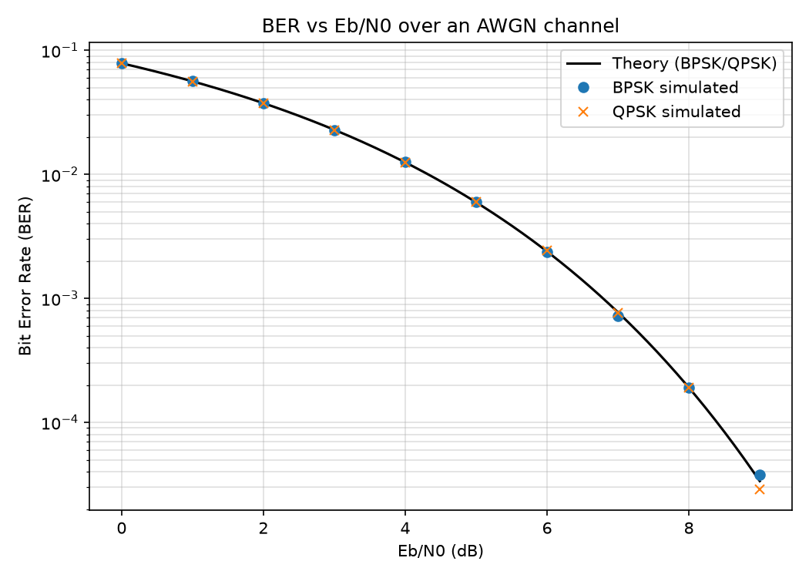
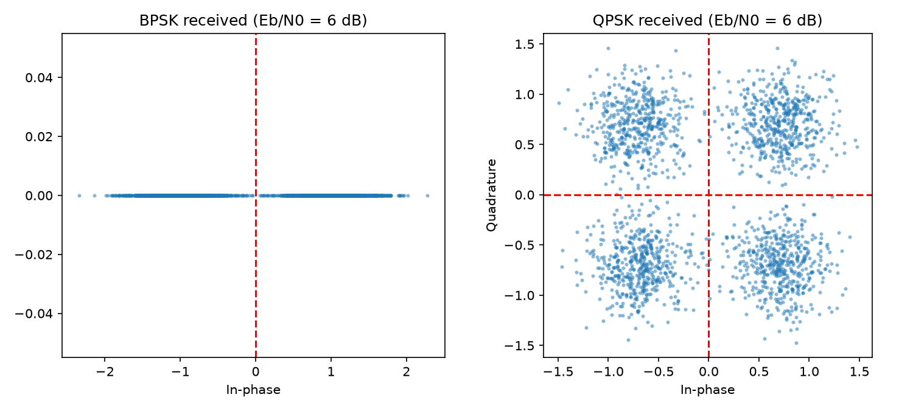

# BPSK/QPSK Communication System Simulation

Python simulation of BPSK and QPSK modulation over an AWGN channel. It measures the bit error rate (BER) across a range of Eb/N0 values and compares the simulated results with the theoretical BER curve.

## What it does

- Generates random bits and modulates them with BPSK (1 bit/symbol) and QPSK (2 bits/symbol)
- Passes the symbols through an AWGN channel at Eb/N0 values from 0 to 9 dB
- Demodulates with a hard decision rule and counts bit errors
- Plots simulated BER against the theoretical curve on a log scale
- Plots the received constellations to show the effect of noise

## System model


## Results

The simulated BER for both BPSK and QPSK follows the theoretical curve `BER = 0.5 * erfc(sqrt(Eb/N0))`. At the highest Eb/N0 values the simulated points become slightly noisy because very few bit errors remain to be counted.





## How to run

```bash
git clone https://github.com/Ravi-Ratna-66/BPSK-QPSK-Simulation.git
cd BPSK-QPSK-Simulation
python -m venv .venv
source .venv/bin/activate        # Windows: .venv\Scripts\activate
pip install -r requirements.txt
python bpsk_qpsk_ber_simulation.py
```

The script prints a BER table to the terminal and saves `ber_curve.png` and `constellations.png`.

## Project structure

```
BPSK-QPSK-Simulation/
├── bpsk_qpsk_ber_simulation.py
├── requirements.txt
├── ber_curve.png
├── constellations.png
└── README.md
```

## Key concepts

- **BPSK:** bit 0 maps to -1 and bit 1 maps to +1
- **QPSK:** two bits per symbol, one on the in-phase axis and one on the quadrature axis
- **AWGN:** additive white Gaussian noise added to each symbol
- **Eb/N0:** energy per bit divided by noise power spectral density
- **BER:** number of wrong bits divided by total bits sent

## Possible extensions

- Rayleigh fading channel
- Hamming(7,4) channel coding
- 16-QAM

## Author

Ravi Ratna Samana